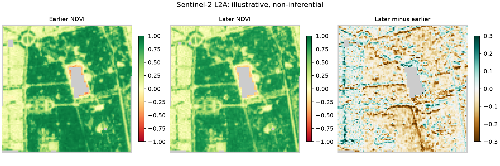

# Environmental Data QA: a reproducible Sentinel-2 example

[](https://github.com/angelicapalma0200-debug/synthetic-environmental-data-qa/actions/workflows/eoqa-offline-ci.yml)

**A small, independent example of geospatial data acquisition and quality assessment.** The previous synthetic-only exercise remains available in [`src/qa_demo.py`](src/qa_demo.py). This repository now also contains a more substantial Earth-observation workflow in [`eoqa/`](eoqa/).

**Two modes:** an **offline, deterministic raster fixture** (runs without internet) and an **optional real-data mode** using public Sentinel-2 Level-2A imagery from Element 84 Earth Search STAC. The example area is a small urban mosaic in Madrid, Spain, outside the author's doctoral study region.

> **Verification status:** 12 new EOQA unit/integration tests passed locally; [public GitHub CI](https://github.com/angelicapalma0200-debug/synthetic-environmental-data-qa/actions/runs/42161230433) passed **15 total tests**, including three retained synthetic numerical QA tests. A separate [GitHub-hosted live run](https://github.com/angelicapalma0200-debug/synthetic-environmental-data-qa/actions/runs/42161351695) **successfully accessed real Sentinel-2 scenes and produced the documented raster outputs**. This is software execution evidence, not independent radiometric or ecological validation.

## Verified public Sentinel-2 demonstration



The reproducible [live GitHub Actions run #42161351695](https://github.com/angelicapalma0200-debug/synthetic-environmental-data-qa/actions/runs/42161351695) processed public scenes `S2B_30TVK_20240417_0_L2A` (17 April 2024) and `S2B_30TVK_20240815_0_L2A` (15 August 2024). Among 10,163 AOI pixels, 9,899 and 9,915 respectively passed the illustrative per-scene QA. There were 9,887 valid paired pixels. All of these counts are **technical processing results** for a small urban example, not claims about ecological change.

- [Inspect the permanent real-data examples (5 GeoTIFFs, PNG, JSON)](examples/real/madrid-2024/)
- [Read the complete machine-readable provenance and QA report](examples/real/madrid-2024/report.json)
- [Inspect the GitHub-hosted validation and publication record](docs/VERIFICATION.md)

The 2024 sample products are attributed as: *Contains modified Copernicus Sentinel data (2024).* Pixel-wise differences are descriptive and may reflect phenology, observation conditions, or processing uncertainties.

## What the workflow does

1. Searches the declared windows using **bounded STAC pagination** (maximum 10 pages or 600 candidates) and selects two scenes. In live mode, the deterministic criterion is lowest scene-wide reported cloud cover among items with required assets and bounding-box coverage.
2. Reads red (B04), NIR (B08), and 20 m SCL scene-classification layers; aligns them onto a fixed 10 m grid with nearest-neighbour resampling.
3. Converts digital numbers to reflectance **without silently double-applying Sentinel-2 processing-baseline offsets**. If the provider's calibration metadata is ambiguous, the pipeline stops instead of guessing.
4. Classifies valid land pixels (SCL 4 and 5), rejects clouds/shadows/water/uncertain classes, and computes NDVI only with valid observations.
5. Exports per-scene NDVI, per-pixel QA, paired-date NDVI difference, and a JSON provenance/quality report. No imputation is performed.

## Quick start (Python 3.10+)

```bash
python -m pip install -r requirements.txt
python -m unittest discover -s tests -v
python -m eoqa.demo --mode offline --out output/offline
```

Outputs appear in `output/offline/results/`. To attempt a small real-data example (requires internet and GDAL HTTP range access):

```bash
python -m eoqa.demo --mode live --config config/madrid_demo.json --out output/live
```

Each run writes `ndvi_earlier.tif`, `ndvi_later.tif`, `qa_earlier.tif`, `qa_later.tif`, `ndvi_difference.tif`, `ndvi_quicklook.png`, and `report.json` (the filenames are generated from period labels). The `output/` folder is excluded from version control.

## Scientific cautions

**This is a software demonstration, not an ecological-change analysis.** Two acquisitions cannot establish a temporal trend. Scene-wide cloud cover does not guarantee clear pixels in a specific AOI. Sentinel-2 SCL is an imperfect classification, and nearest-neighbour resampling preserves classes but cannot restore subpixel detail. The paired difference is calculated only on pixels valid in *both* scenes; support varies, and reported means are descriptive rather than inferential. No accuracy, classification or cross-sensor validation is claimed.

The live selection tests only bounding-box containment, not exact pixel-footprint coverage. A scene may therefore have incomplete local coverage, which must be evaluated through the final QA counts. The calibration policy specifically addresses a documented Earth Search metadata ambiguity (see [methods and sources](docs/METHODS.md)).

## Development and transparency

This independent demonstration was developed with AI assistance. It uses public Sentinel-2 imagery and clearly identified synthetic test data. Source code, methods, automated tests, and public execution records are provided for review and reproducibility. No confidential research data, credentials, or unpublished results are included.

## Methods and references

- [Methods, assumptions, reproducibility and authoritative sources](docs/METHODS.md)
- [Offline test and execution verification record](docs/VERIFICATION.md)
- [`config/madrid_demo.json`](config/madrid_demo.json) specifies the public example location, resolution and search windows.
- [Original synthetic numerical QA exercise](src/qa_demo.py) remains available for comparison.

**Attribution for source imagery when live mode is used:** Contains modified Copernicus Sentinel data (2024), processed with this demonstration software. No original satellite data are redistributed here.
